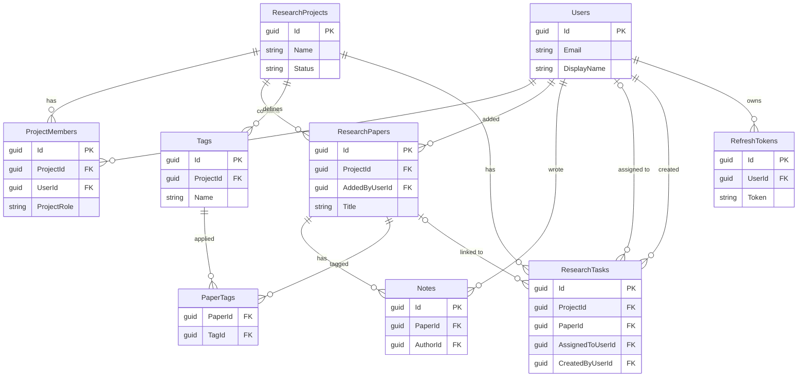

# Database design

ResearchHub stores its data in SQL Server through Entity Framework Core. The schema is created only by migrations (`src/ResearchHub.Infrastructure/Migrations`), and the mapping lives in Fluent API configuration classes (`src/ResearchHub.Infrastructure/Persistence/Configurations`). The Domain layer carries no persistence attributes.

## Overview

Key columns only. Full column lists follow in the next section.



## Conventions

- **Keys** are `uniqueidentifier` values assigned by the domain when an entity is constructed, never by the database. `ProjectMember.Id` is configured `ValueGeneratedNever` for this reason, so EF Core inserts a member added to an already tracked project instead of trying to update it.
- **Enums are stored as strings** (`nvarchar(20)`), using the C# member names. The database stays readable, and reordering an enum cannot corrupt stored data. There is no `CHECK` constraint on these columns, so the allowed values are enforced by the API and the domain, not by the database.
- **Timestamps** are UTC `datetime2`, set by the domain.
- **Nullability follows C# nullability.** Properties declared with `?` are nullable columns, and everything else is `NOT NULL`.
- **Indexes on foreign keys:** EF Core adds a non-unique index to every foreign key column by convention. Those are not repeated below unless they were configured explicitly.

## Tables

### Users

| Column | Type | Notes |
|---|---|---|
| Id | uniqueidentifier | Primary key |
| Email | nvarchar(256) | Unique. Stored trimmed and lowercase. |
| DisplayName | nvarchar(100) | |
| PasswordHash | nvarchar(max) | `salt.hash.iterations`. Never returned by the API. |
| PlatformRole | nvarchar(20) | `User` or `Admin` |
| CreatedAt | datetime2 | |

### ResearchProjects

| Column | Type | Notes |
|---|---|---|
| Id | uniqueidentifier | Primary key |
| Name | nvarchar(200) | |
| Description | nvarchar(2000) | |
| Status | nvarchar(20) | `Active`, `Completed` or `Archived` |
| CreatedAt | datetime2 | |

### ProjectMembers

A join entity that carries data (the role), so it is a real table with its own key rather than a bare many-to-many.

| Column | Type | Notes |
|---|---|---|
| Id | uniqueidentifier | Primary key |
| ProjectId | uniqueidentifier | Foreign key to ResearchProjects |
| UserId | uniqueidentifier | Foreign key to Users |
| ProjectRole | nvarchar(20) | `Owner` or `Member` |
| JoinedAt | datetime2 | |

Unique index on `(ProjectId, UserId)`, so a user cannot join a project twice.

### ResearchPapers

| Column | Type | Notes |
|---|---|---|
| Id | uniqueidentifier | Primary key |
| ProjectId | uniqueidentifier | Foreign key to ResearchProjects |
| Title | nvarchar(500) | |
| Authors | nvarchar(1000) | Free text. Authors are not a separate entity in the MVP. |
| Abstract | nvarchar(4000) | |
| PublicationDate | datetime2 | Nullable |
| DoiOrUrl | nvarchar(500) | Nullable |
| PdfReference | nvarchar(500) | Nullable. A reference, not file storage. |
| AddedByUserId | uniqueidentifier | Foreign key to Users |
| CreatedAt | datetime2 | |

### Tags

| Column | Type | Notes |
|---|---|---|
| Id | uniqueidentifier | Primary key |
| ProjectId | uniqueidentifier | Foreign key to ResearchProjects. Tags belong to one project. |
| Name | nvarchar(100) | Stored trimmed and lowercase |

Unique index on `(ProjectId, Name)`: a project cannot have two tags with the same name, but two projects can each have their own.

### PaperTags

The pure many-to-many join table between papers and tags. EF Core manages it, so there is no entity class in the Domain. Its primary key is the pair of its two foreign key columns, one referencing ResearchPapers and one referencing Tags.

### Notes

| Column | Type | Notes |
|---|---|---|
| Id | uniqueidentifier | Primary key |
| PaperId | uniqueidentifier | Foreign key to ResearchPapers |
| AuthorId | uniqueidentifier | Foreign key to Users |
| Content | nvarchar(4000) | |
| CreatedAt | datetime2 | |
| UpdatedAt | datetime2 | Nullable. Null until the first edit. |

### ResearchTasks

| Column | Type | Notes |
|---|---|---|
| Id | uniqueidentifier | Primary key |
| ProjectId | uniqueidentifier | Foreign key to ResearchProjects |
| PaperId | uniqueidentifier | Nullable foreign key to ResearchPapers |
| Title | nvarchar(300) | |
| Description | nvarchar(2000) | |
| Status | nvarchar(20) | `ToDo`, `InProgress` or `Done` |
| Priority | nvarchar(20) | `Low`, `Medium` or `High` |
| Deadline | datetime2 | Nullable |
| AssignedToUserId | uniqueidentifier | Nullable foreign key to Users |
| CreatedByUserId | uniqueidentifier | Foreign key to Users |
| CreatedAt | datetime2 | |
| CompletedAt | datetime2 | Nullable. Set when the task becomes Done, cleared if reopened. |

### RefreshTokens

| Column | Type | Notes |
|---|---|---|
| Id | uniqueidentifier | Primary key |
| UserId | uniqueidentifier | Foreign key to Users |
| Token | nvarchar(200) | Unique. Stored as issued. |
| ExpiresAt | datetime2 | |
| CreatedAt | datetime2 | |
| RevokedAt | datetime2 | Nullable. Whether a token is active is computed in code, not stored. |

## Relationships

**One-to-many:**

- Project to members, papers, tags and tasks
- Paper to notes
- User to the papers they added, the notes they wrote, the tasks they created, the tasks assigned to them, and their refresh tokens
- Paper to tasks (optional: a task may or may not link to a paper)

**Many-to-many:**

- Users and projects, through `ProjectMembers` (a join entity with a role)
- Papers and tags, through `PaperTags` (a pure join table)

**One-to-one:** none.

## Delete behaviour

Each relationship's behaviour was chosen for what the data means, rather than left at a default.

| Relationship | On delete | Reason |
|---|---|---|
| Project to ProjectMembers | Cascade | A membership means nothing without its project |
| Project to ResearchPapers, Tags, ResearchTasks | No action (blocked) | See below |
| Paper to Notes | Cascade | A note has no meaning without its paper |
| Paper to PaperTags, Tag to PaperTags | Cascade | Link rows only exist for the things they connect |
| Paper to ResearchTasks | Set null | A task survives its paper and simply becomes unlinked |
| User to anything they created or are assigned | No action (blocked) | Deleting a user must never silently remove other people's work. Users cannot be deleted today. |
| User to RefreshTokens | Cascade | Tokens are worthless without their user |

**Why projects do not cascade to their contents.** SQL Server rejects schemas where a table can be reached by more than one cascading path. A project reaches `PaperTags` through its papers and through its tags, and reaches a task directly and through a paper (`SET NULL` counts as cascading). The schema therefore uses two cooperating mechanisms:

1. The foreign keys from papers, tags and tasks to their project use **no action**, so the database refuses to delete a project that still has contents, and a paper can never point at a project that does not exist.
2. Deleting a project goes through `ProjectRepository.RemoveWithContentsAsync`, which removes the tasks, papers (their notes and tag links cascade in the database), tags and finally the project, all in one `SaveChanges` and therefore one transaction.

Before this was fixed, the three project foreign keys did not exist at all, and deleting a project left its papers, tags and tasks behind as unreachable rows. Integration tests now guard both the cleanup and the constraint.

## Indexes

| Index | Kind | Purpose |
|---|---|---|
| `Users (Email)` | Unique | One account per email, and fast login lookup |
| `ProjectMembers (ProjectId, UserId)` | Unique | No duplicate memberships |
| `Tags (ProjectId, Name)` | Unique | Tag names are unique within a project |
| `RefreshTokens (Token)` | Unique | Fast, unambiguous token lookup |
| `ResearchPapers (ProjectId)` | Non-unique | Almost every paper query filters by project |
| `ResearchPapers (PublicationDate)` | Non-unique | Date range filtering |
| `ResearchTasks (ProjectId)` | Non-unique | Listing a project's tasks |
| `ResearchTasks (AssignedToUserId)` | Non-unique | Finding a person's tasks |
| `Notes (PaperId)` | Non-unique | Listing a paper's notes |

Text search uses `LIKE '%term%'`, which cannot use an index. That is acceptable at this scale, and a full-text index is the planned upgrade.

## What the database does not enforce

These rules are enforced in code only. A direct SQL write could violate them.

- A project always keeps at least one Owner (Domain, `ResearchProject`).
- A paper's tags belong to the paper's own project (Domain, `ResearchPaper.AddTag`). Nothing stops a raw insert into `PaperTags` from linking across projects.
- A task's assignee is a member of the task's project, and a task's linked paper belongs to the same project (Application, `ResearchTaskService`).
- The allowed values of the string-backed enum columns.
- Who may read or change what (Application services).

## Data lifecycle

- **Removing a member** only deletes the membership row. The papers, notes and tasks they created remain.
- **Deleting a paper** deletes its notes and tag links. Tasks that referenced it stay and lose the link.
- **Deleting a project** deletes everything inside it, in one transaction (see above).
- **Deleting users and changing a user's email** are not supported yet.

## Migrations

| Migration | What it does |
|---|---|
| `InitialCreate` | The full domain schema |
| `AddRefreshTokens` | The `RefreshTokens` table |
| `ProjectMemberIdAssignedByDomain` | Empty. Updates the model snapshot after `ProjectMember.Id` was set to `ValueGeneratedNever`. |
| `EnforceProjectForeignKeys` | Adds the missing foreign keys from papers, tags and tasks to projects |

Common commands, run from the repository root:

```bash
# create a migration after changing an entity or a configuration
dotnet ef migrations add <Name> --project src/ResearchHub.Infrastructure --startup-project src/ResearchHub.API

# apply pending migrations
dotnet ef database update --project src/ResearchHub.Infrastructure --startup-project src/ResearchHub.API
```

Always read the generated `Up()` method before applying it.

## Inspecting the schema

To list every foreign key with its delete behaviour:

```sql
SELECT OBJECT_NAME(fk.parent_object_id) AS ChildTable,
       OBJECT_NAME(fk.referenced_object_id) AS ParentTable,
       fk.delete_referential_action_desc AS OnDelete
FROM sys.foreign_keys fk
ORDER BY ChildTable, ParentTable;
```
